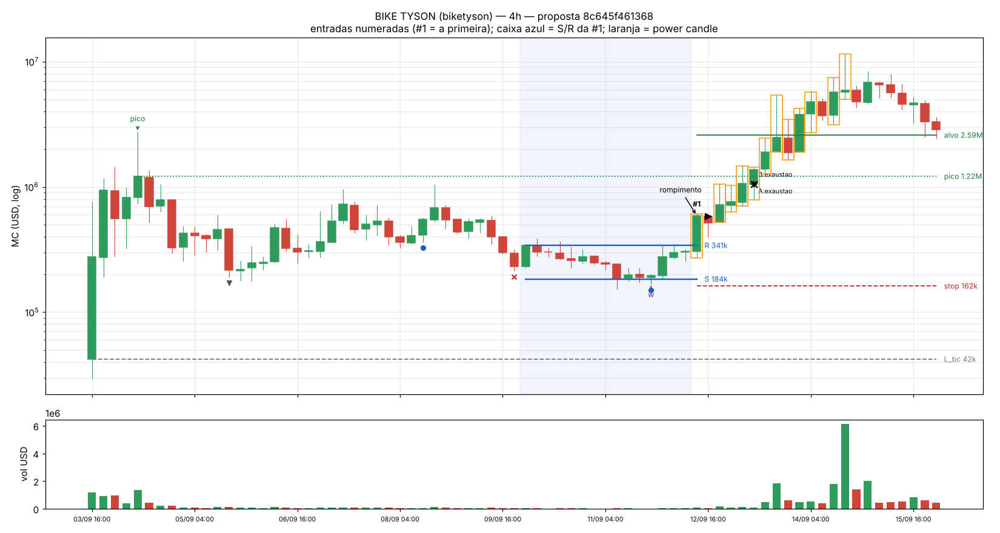
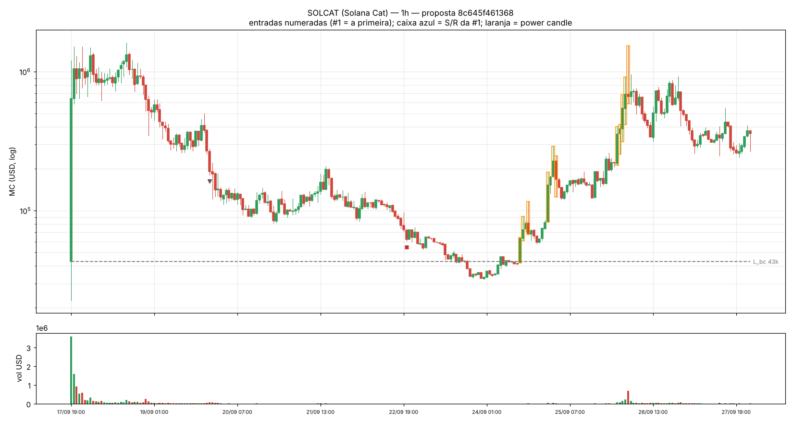
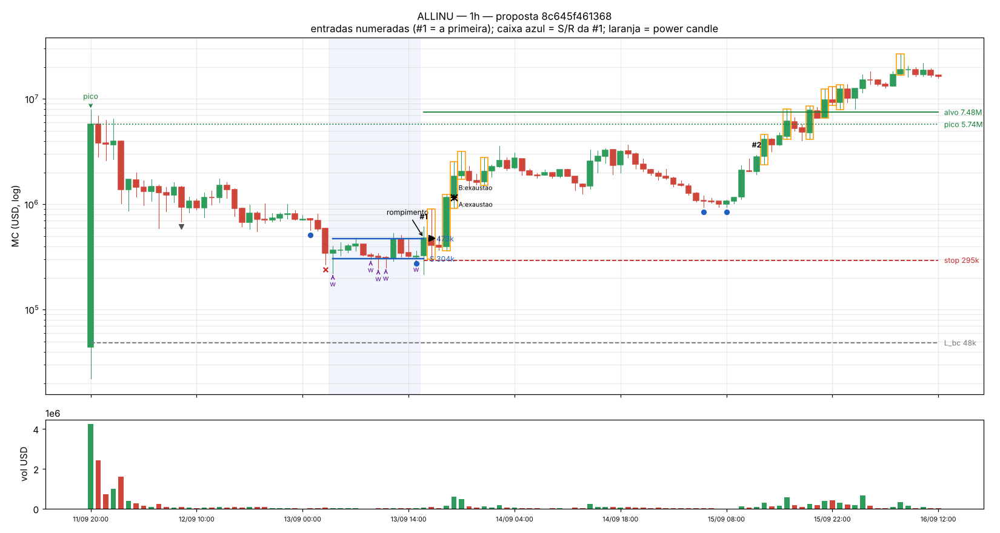
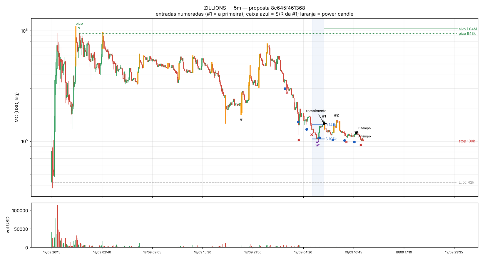
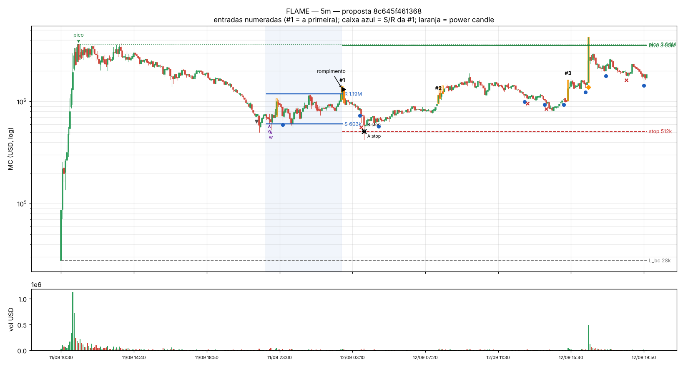

# POS-RUNNER-V0 — Passo 0: calibração com os 5 exemplos do professor

Gerado em 2026-10-15T23:22:05Z. **Isto é calibração, não avaliação**: os 5 exemplos são vencedores escolhidos depois e ficam fora de todas as métricas de resultado. Nada foi congelado; nenhum backtest foi rodado.

- Config do handoff (valores da seção 2): `adf3b4f67bf4`
- Config proposta (este relatório): `8c645f461368` — arquivo `signals_mvp/pos_runner/pos_runner_v0.yaml`

## Resumo

1. **Contratos**: os 5 mints e pools existem e a linhagem foi conferida on-chain. Duas correções na tabela do handoff: ALLINU **não é Meteora** — é Raydium LaunchLab cotado em DKNG (o pool do handoff, Meteora DLMM, foi criado 54 min depois por outra carteira; o preço é o mesmo); e o **SOLCAT está em ~30k de MC hoje, não ~575k** (o resto bate com o que o handoff descreve). Os 3 launchpads aparecem: pump.fun (BIKE, SOLCAT), Raydium LaunchLab (ALLINU, ZILLIONS) e Meteora DBC (FLAME).
2. **Com os números do handoff ao pé da letra** o detector só acha entrada em: FLAME (2026-09-12T02:35:00Z). Nos outros a onda é invalidada antes, porque a queda medida de pavio a pavio (topo do runner até o fundo) passa do teto de 90%: BIKE 94%, SOLCAT 98%, ALLINU 97%, ZILL 91%.
3. **Proposta (4 mudanças)**: medir pico, queda e caixa pelos **corpos** dos candles; teto de queda **95%**; martelo com pavio **≥ 1,5× o corpo**; alvo no **topo real** (máxima). Com isso o detector reconhece **4 de 5** (BIKE, ALLINU, FLAME e uma entrada no ZILLIONS que provavelmente não é a do professor). Os números de caixa (12 candles, R/S ≤ 3, zona de 5%) não mudaram nada nos exemplos e ficam como no handoff.
4. **SOLCAT não é reconhecido com nenhuma variante**: a base de 23–24/09 ficou ~25% **abaixo** do nível da bonding curve (L_bc ≈ 43k) e a queda total foi de 98%. Pela regra do próprio operador ("fundo acima da bonding curve") esse trecho é inválido — preciso saber se o setup do professor é esse.
5. **Filtro de idade**: o BIKE rompeu com 9 dias e o ALLINU com 1,9 dia; a janela de 2–7 dias do handoff tiraria os dois do resultado primário. Proposta: idade só como atributo (com resultado por faixa de idade).

## 1. Os 5 exemplos, conferidos on-chain

| Exemplo | Launchpad (on-chain) | Pool de graduação | Cotação | Graduação (UTC) | L_bc (MC na graduação) | Observação |
|---|---|---|---|---|---|---|
| BIKE TYSON (biketyson) | pumpfun — `pump.fun MigrateV2 -> PumpSwap CreatePool` | `41rzTMB7JHPTyMXzrYwdqnBecJRhkb8KHYAjrQ9cYxJx` | SOL | 2026-09-03T16:16:10Z | 42k | 1a assinatura do mint (11:08) e uma transacao que falhou; a criacao na curva e logo depois. |
| SOLCAT (Solana Cat) | pumpfun — `pump.fun MigrateV2 -> PumpSwap CreatePool (curva Gkxp9pv7... completou 19:15:41)` | `9Hr6NXw5WSffxNQnqxwZyhRw81uz3PpB7RF9J3i9nMt1` | SOL | 2026-09-17T19:15:41Z | 43k | mint criado com pump.fun CreateV2 (sem sufixo 'pump'). Handoff dizia MC ~575k em 15/10; o GT mostra ~30k. |
| ALLINU | raydium_launchlab — `LaunchLab MigrateToCpswap -> Raydium CPMM InitializeWithPermission (LP travada)` | `5752ia7jC3ZU1c8ycytaSyi5D4nVhApSKvreGbs7pwWL` | DKNG | 2026-09-11T20:02:17Z | 48k | NAO e Meteora: e Raydium LaunchLab cotado em DKNG. O pool do handoff (4iVH, Meteora DLMM) foi criado 54 min depois da graduacao por outra carteira. A curva completou em 23 s. |
| ZILLIONS | raydium_launchlab — `LaunchLab MigrateToCpswap -> Raydium CPMM InitializeWithPermission (LP travada)` | `82BhSZXxSXBKsAmyHJ5NxkCd6JrSUBrmPsxYgu7Byvns` | ZEC | 2026-09-17T20:16:33Z | 42k | cotado em ZEC (Zcash na Solana). O USD do GeckoTerminal deste pool fica travado em ~1,0M entre 18/09 12h e 19/09 12h; a serie usada aqui e a taxa em ZEC x ZEC/USDC. |
| FLAME | meteora_dbc — `Meteora DBC MigrationDammV2 -> DAMM v2 InitializePoolWithDynamicConfig (posicao travada)` | `23B6d3FvDu2eiZxyBLgWdm2W2vn1bdRwJTR6NCfQpxGE` | EMBER | 2026-09-11T10:32:54Z | 28k | cotado em EMBER. O pool FLAME/SOL mais antigo (BdEx, 10:06) foi criado por terceiro durante a curva. |

Dados: OHLCV do GeckoTerminal do pool de graduação, pedido **em token de cotação** e convertido com a cotação/USD de referência. No ZILLIONS o USD do próprio GeckoTerminal ficou travado em ~1,0M por 24 h (erro de até 364% contra o pool ZILLIONS/SOL); a série convertida bate com os pools independentes cotados em SOL (diferença mediana de 1–2% no FLAME e no ALLINU). Todas as séries de 5m conferidas contra o 1h: zero buracos.

## 2. O que o detector vê (gráficos)

### BIKE TYSON (biketyson) — 4h (timeframe do professor)

- Com os parâmetros do handoff: nenhuma entrada nesta janela.
- Com a proposta: #1 2026-09-12T12:00:00Z.
- Visão geral do histórico no 1h: `BIKE_1h_visao_geral.png`

### SOLCAT (Solana Cat) — 1h (timeframe do professor)

- Com os parâmetros do handoff: nenhuma entrada nesta janela.
- Com a proposta: nenhuma entrada nesta janela.
- Onda invalidada em 2026-09-22T20:00:00Z: queda passou de 95%.
- Visão geral do histórico no 1h: `SOLCAT_1h_visao_geral.png`

### ALLINU — 1h (o professor não informou o timeframe)

- Com os parâmetros do handoff: nenhuma entrada nesta janela.
- Com a proposta: #1 2026-09-13T16:00:00Z, #2 2026-09-15T12:00:00Z.
- Visão geral do histórico no 1h: `ALLINU_1h_visao_geral.png`

### ZILLIONS — 5m (o professor não informou o timeframe)

- Com os parâmetros do handoff: nenhuma entrada nesta janela.
- Com a proposta: #1 2026-09-19T07:00:00Z, #2 2026-09-19T08:35:00Z.
- Visão geral do histórico no 1h: `ZILL_1h_visao_geral.png`

### FLAME — 5m (timeframe do professor)

- Com os parâmetros do handoff: 2026-09-12T02:35:00Z.
- Com a proposta: #1 2026-09-12T02:35:00Z, #2 2026-09-12T08:05:00Z, #3 2026-09-12T15:30:00Z.
- Visão geral do histórico no 1h: `FLAME_1h_visao_geral.png`

## 3. Medidas reais de cada exemplo (proposta)

| medida | BIKE #1 | ALLINU #1 | ALLINU #2 | ZILL #1 | ZILL #2 | FLAME #1 | FLAME #2 |
|---|---|---|---|---|---|---|---|
| tf | 4h | 1h | 1h | 5m | 5m | 5m | 5m |
| rompimento | 2026-09-12T12:00:00Z | 2026-09-13T16:00:00Z | 2026-09-15T12:00:00Z | 2026-09-19T07:00:00Z | 2026-09-19T08:35:00Z | 2026-09-12T02:35:00Z | 2026-09-12T08:05:00Z |
| idade_d | 8.99 | 1.87 | 3.71 | 1.45 | 1.52 | 0.67 | 0.90 |
| P_peak | 1.22M | 5.74M | 5.74M | 943k | 943k | 3.64M | 3.64M |
| topo_maxima | 2.73M | 7.88M | 7.88M | 1.09M | 1.09M | 3.74M | 3.74M |
| topo_em_h_desde_graduacao | 19.70 | 1.00 | 1.00 | 3.10 | 3.10 | 1.80 | 1.80 |
| L_bc | 42k | 48k | 48k | 42k | 42k | 28k | 28k |
| queda_pct | 84.90 | 94.70 | 94.70 | 88.90 | 88.90 | 84.40 | 84.40 |
| caixa_candles | 15 | 12 | 15 | 18 | 18 | 52 | 52 |
| S | 184k | 304k | 1.01M | 105k | 113k | 603k | 578k |
| R | 341k | 473k | 2.42M | 141k | 145k | 1.19M | 941k |
| R_S | 1.85 | 1.56 | 2.41 | 1.34 | 1.28 | 1.97 | 1.63 |
| n_wicks | 1 | 5 | 2 | 2 | 1 | 2 | 1 |
| pavio_sobre_corpo_mediana | 3.30 | 4.90 | 6.20 | 26.20 | 3.70 | 3.60 | 1.60 |
| vol_rompimento_x_media | 4.70 | 2.90 | 2.50 | 2.10 | 5.30 | 2.40 | 3.70 |
| amplitude_rompimento_atr | 3.60 | 2.70 | 1.90 | 2.10 | 4.40 | 4.20 | 5.60 |
| power_candle | sim | não | não | não | sim | sim | sim |
| cobertura_R_ate_pico | 0.11 | 0.02 | 0.10 | 0.01 | 0.01 | 0.08 | 0.08 |
| entrada | 586k | 477k | 2.87M | 145k | 155k | 1.32M | 1.20M |
| stop | 162k | 295k | 998k | 100k | 111k | 512k | 546k |
| alvo | 2.59M | 7.48M | 7.48M | 1.04M | 1.04M | 3.55M | 3.55M |
| subida_max_48c_pct | 1866.00 | 1572.30 | 951.40 | 7.40 | 0.30 | 0.10 | 57.20 |
| chegou_no_alvo | sim | sim | sim | não | não | sim | sim |
| candles_ate_alvo | 7 | 48 | 4 | — | — | 169 | 103 |
| saida_A | +71.7% liq (exaustao, 5 candles) | +132.8% liq (exaustao, 4 candles) | +149.6% liq (alvo, 4 candles) | -21.6% liq (tempo, 49 candles) | -31.7% liq (stop, 15 candles) | -63.1% liq (stop, 15 candles) | +9.5% liq (tempo, 49 candles) |
| saida_B | +71.7% liq (exaustao, 5 candles) | +132.8% liq (exaustao, 4 candles) | +126.8% liq (exaustao, 5 candles) | -21.6% liq (tempo, 49 candles) | -31.7% liq (stop, 15 candles) | -63.1% liq (stop, 15 candles) | +9.5% liq (tempo, 49 candles) |

SOLCAT não tem entrada (a onda é invalidada antes). Geometria medida no trecho 17/09–27/09 (1h):

| medida | valor |
|---|---|
| tf | 1h |
| topo | 1.62M |
| topo_em_h_desde_graduacao | 20.70 |
| fundo_pavio | 32k |
| fundo_corpo | 32k |
| queda_pavio_pct | 98.00 |
| L_bc | 43k |
| fundo_abaixo_de_L_bc_pct | 24.60 |
| fundo_em | 2026-09-24T00:00:00Z |
| subiu_depois_ate | 1.54M |
| chegou_a_95pct_do_topo | sim |

## 4. Varredura (só para achar o mínimo que reconhece os exemplos)

36 variantes = measure ['wick', 'body'] × drop_max [0.9, 0.95, 0.97] × wick_body_mult [2.0, 1.5, 1.0] × box_max_ratio [3.0, 4.0] (alvo no topo real e sem filtro de idade em todas). "Reconhece" = alguma ENTRADA dentro da janela que eu li no gráfico como o rompimento do professor (a confirmar).

- BIKE: reconhecido em 18 de 36 variantes
- ALLINU: reconhecido em 12 de 36 variantes
- FLAME: reconhecido em 21 de 36 variantes
- SOLCAT: reconhecido em 0 de 36 variantes
- ZILL: reconhecido em 22 de 36 variantes
- Máximo reconhecido por uma variante: 4 de 5.

Variantes que chegam no máximo: {"measure": "body", "drop_max": 0.95, "wick_body_mult": 1.5, "box_max_ratio": 3.0}; {"measure": "body", "drop_max": 0.95, "wick_body_mult": 1.5, "box_max_ratio": 4.0}; {"measure": "body", "drop_max": 0.95, "wick_body_mult": 1.0, "box_max_ratio": 3.0}; {"measure": "body", "drop_max": 0.95, "wick_body_mult": 1.0, "box_max_ratio": 4.0}; {"measure": "body", "drop_max": 0.97, "wick_body_mult": 1.5, "box_max_ratio": 3.0}; {"measure": "body", "drop_max": 0.97, "wick_body_mult": 1.5, "box_max_ratio": 4.0}; {"measure": "body", "drop_max": 0.97, "wick_body_mult": 1.0, "box_max_ratio": 3.0}; {"measure": "body", "drop_max": 0.97, "wick_body_mult": 1.0, "box_max_ratio": 4.0}

## 5. Proposta de parâmetros e o motivo de cada número

| parâmetro | handoff | proposta | motivo |
|---|---|---|---|
| `measure` | "wick" | "body" | Suporte/resistência horizontais se traçam nos corpos; os pavios são os "testes" (wicks). Com pavios, um único print (sniper, falso rompimento) estica R e quebra a regra R/S (ALLINU 1h) e a queda passa de 90% em quase todos. Medido pelos corpos no timeframe do professor, o BIKE caiu 85% — dentro dos 80–90%. |
| `drop_max` | 0.9 | 0.95 | Pelos corpos, as quedas dos exemplos reconhecidos foram de 84% a 95% (ALLINU 1h: 94,7% até a base). 90% tira o ALLINU. A invalidação do operador é furar L_bc, que continua valendo; 95% é o menor valor da grade que reconhece o ALLINU (97% dá o mesmo resultado). |
| `wick_body_mult` | 2.0 | 1.5 | Com 2×, o candle de capitulação do FLAME (pavio 1,3–1,4× o corpo) não conta como wick e o rompimento verdadeiro de 12/09 08:05 não arma. 1,5× é o maior valor da grade que reconhece o FLAME (1,0× dá o mesmo resultado). |
| `tp_reference` | "measure" | "wick" | "Saída no último topo": o topo é onde o preço negociou (a máxima), não o topo do corpo. Só muda o alvo e o teste do candle absurdo. |
| `age_window_days` | {"5m": null, "1h": [2.0, 7.0], "4h": [2.0, 7.0]} | {"5m": null, "1h": null, "4h": null} | BIKE rompeu com 9,0 dias e ALLINU com 1,9 dia: a janela de 2–7 dias tiraria 2 dos 4 exemplos reconhecidos do resultado primário. Proposta: só atributo (resultado reportado por faixa de idade). Pergunta abaixo. |
| `runner_min_mc` | 300000.0 | 300000.0 | igual ao handoff |
| `drop_min` | 0.8 | 0.8 | igual ao handoff |
| `bounce_fractal` | 2 | 2 | igual ao handoff |
| `box_min_candles` | 12 | 12 | igual ao handoff |
| `box_max_ratio` | 3.0 | 3.0 | igual ao handoff |
| `wick_zone` | 0.05 | 0.05 | igual ao handoff |
| `wick_min` | 1 | 1 | igual ao handoff |
| `wick_break` | 0.02 | 0.02 | igual ao handoff |
| `breakout_vol_mult` | 2.0 | 2.0 | igual ao handoff |
| `atr_period` | 20 | 20 | igual ao handoff |
| `power_atr_mult` | 3.0 | 3.0 | igual ao handoff |
| `absurd_frac` | 0.5 | 0.5 | igual ao handoff |
| `stop_below_wick` | 0.03 | 0.03 | igual ao handoff |
| `tp_frac_of_peak` | 0.95 | 0.95 | igual ao handoff |
| `exhaustion_gain` | 0.5 | 0.5 | igual ao handoff |
| `time_stop_candles` | 48 | 48 | igual ao handoff |
| `partial_frac` | 0.5 | 0.5 | igual ao handoff |
| `trail_frac` | 0.25 | 0.25 | igual ao handoff |

Mudanças de desenho (não são números, valem para todas as variantes):

- **Caixa** = o maior trecho **recente** depois do 1º repique que cabe em R/S ≤ 3. Ao pé da letra (caixa = tudo desde o 1º repique), o pico do meio da lateral do BIKE (09/07–09/08, ~1M) faz R/S passar de 6 e mata o setup.
- **Uma decisão por caixa**: depois de uma entrada, a caixa recomeça; setups seguintes no mesmo token viram diagnóstico (o handoff manda registrá-los). No 5m isso gera muitas caixas pequenas (faixa de 2–10%): só a primeira entrada por token e timeframe conta no resultado primário.
- **Preço** em token de cotação × cotação/USD (por causa do erro do USD do GeckoTerminal no ZILLIONS).

## 6. O que o detector ainda não vê (e por quê)

- **SOLCAT**: queda de 98% e base ~25% abaixo de L_bc. Se o setup do professor for a base de 23–24/09, a regra "fundo acima da bonding curve" precisaria de tolerância — mas aí ela deixa de ser a regra do operador.
- **FLAME**: a 1ª entrada (12/09 02:35) foi um falso rompimento e bateu o stop (−63% líquido: o stop fica abaixo da wick, longe da entrada). O movimento verdadeiro (08:05 em diante, que chegou ao topo às 16:00) aparece como entrada #2 — diagnóstico, não primária. É o comportamento correto da regra "só o 1º setup conta".
- **ZILLIONS**: não sei qual trecho é o do professor. As entradas que o detector acha (19/09) deram prejuízo. O handoff cita MC ~135k, que é o preço de hoje (15/10), quando o token acabou de subir de ~6k para ~300k — um runner novo, ainda sem fase 2.
- **Saída por exaustão**: a regra do handoff (power candle verde com +50% desde a entrada) sai cedo em movimentos grandes — no ALLINU #1 a saída A foi +132.8% liq (exaustao, 4 candles), e a máxima nas 48 horas seguintes ficou 1572% acima da entrada. O operador escreveu "power candle perto do topo = exaustão"; uma leitura alternativa seria "preço já perto do último topo". Mantive a do handoff.
- **Candles** aproximam wicks e rompimentos (não sabemos a ordem dos preços dentro do candle; tocar stop e alvo no mesmo candle conta como stop).

## 7. Perguntas ao operador (respostas destravam o congelamento)

1. Os gráficos acima são os tokens que o professor mostrou? Em especial o **SOLCAT** (MC ~30k hoje, não ~575k) e o **ZILLIONS** (qual trecho/data?).
2. Em cada gráfico, qual é o setup do professor? Basta o número da entrada (#1, #2…) ou a data do rompimento.
3. **SOLCAT**: a base de 23–24/09 ficou abaixo do nível da bonding curve. A regra "fundo acima da bonding curve" continua valendo (SOLCAT fica de fora) ou tem tolerância?
4. "Tokens de 2–7 dias em fase 2": é a **idade do token** desde a graduação, ou o **tempo na fase 2**? Pode ficar só como atributo (proposta)?
5. Saída por exaustão: "+50% desde a entrada" (handoff) ou "perto do último topo"?
6. Aprova a proposta (corpos, queda até 95%, martelo ≥ 1,5× corpo, alvo no topo real)?
7. Parte A: horizonte de observação de 14 dias depois da graduação e mínimo de 20 trades no holdout — ok?
8. O POS-RUNNER ocupa o "caminho 2" da regra de parada do programa?

## 8. Próximo passo

Com as respostas: congelar a config (hash) no pré-registro `docs/pos-runner-v0-preregistration-DRAFT-2026-10-15.md`, commitar, e só então rodar a Parte A (universo sem viés: a enumeração já acha a graduação dos 5 exemplos nos 3 launchpads). A Parte B (sinal ao vivo no bot) usa a mesma config congelada.
