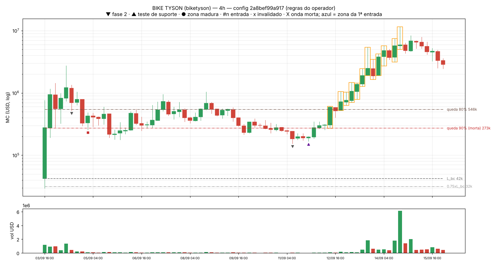
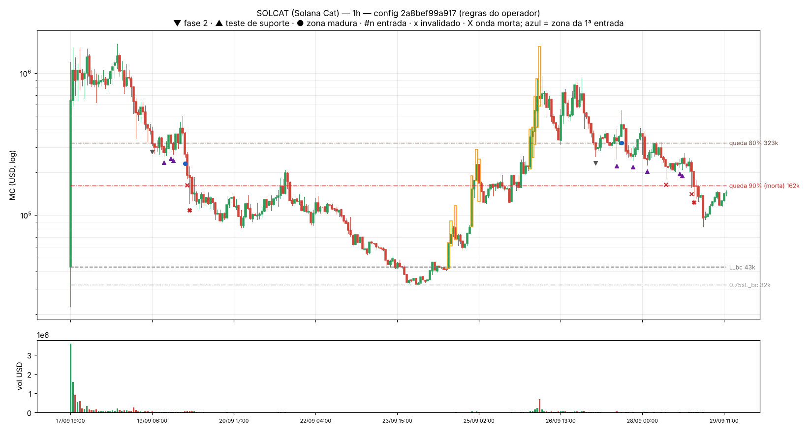
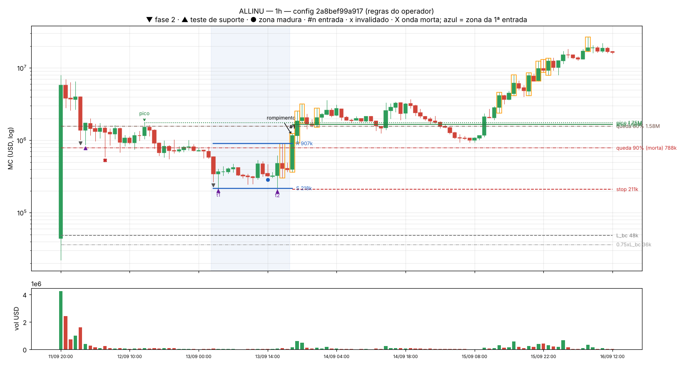
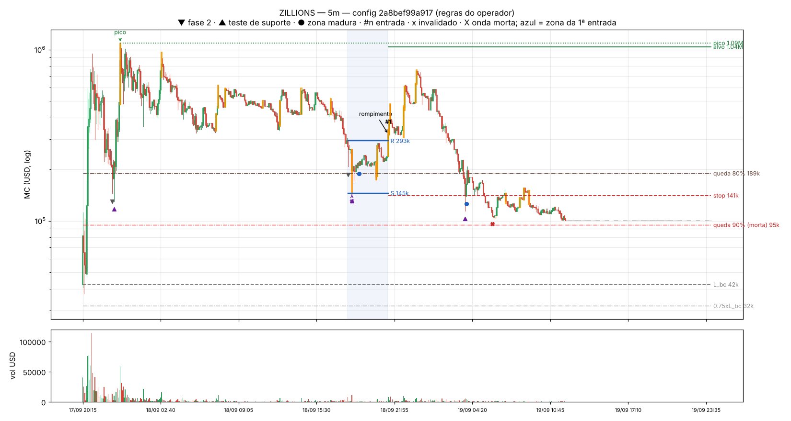
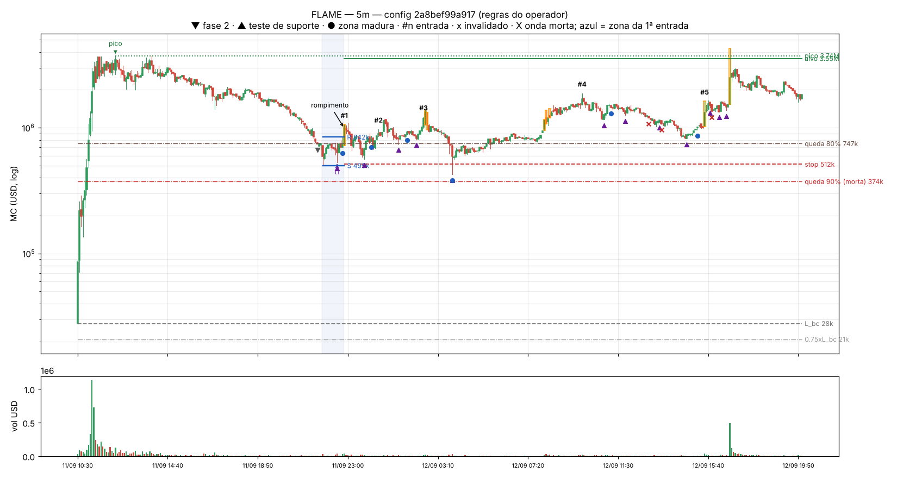

# POS-RUNNER-V0 — Passo 0, versão 2: o que o detector vê nos 5 exemplos (regras do operador)

Gerado em 2026-10-16T09:23:46Z. Config candidata a congelamento: `2a8bef99a917` (`signals_mvp/pos_runner/pos_runner_v0.yaml`). **Calibração da detecção, não avaliação**: os 5 exemplos ficam fora de todas as métricas; aqui não há varredura de parâmetros nem resultado de trade (por decisão do operador, os parâmetros de entrada vêm das regras dele, não de "acertar" os exemplos). Mesmos candles da versão 1 (instantâneo de 2026-10-15 em `passo0_relatorio/dados/`, sem rede).

Regras aplicadas (todas do operador; o que ele não respondeu seguiu a opção mais conservadora — lista no pré-registro):

- **Fase 1**: pico (máxima) da onda ≥ 300,000; a faixa do pico é atributo (300–500k, 500k–1M, 1–5M, >5M).
- **Fase 2**: queda (mínima desde o pico) ≥ 80% abre a zona; queda > 90% = moeda morta; fundo < 0.75 × L_bc = onda inválida. R = máxima das tentativas de subida depois do fundo, **incluindo o 1º repique** (que nunca é comprado).
- **Teste de suporte**: de dentro da zona, a mínima desce a ≤ S × 1.10 e depois o preço fecha de volta ≥ min((S+R)/2, S × 1.25); 1 ou muitos candles. Fechamento < mínima do último teste − 2% = setup morto; stop = mínima do último teste − 3%.
- **Entrada**: zona madura (≥ 12 candles desde o fundo e ≥ 1 teste) e fechamento acima de R; sem exigência de volume; veto se um candle cobre ≥ 50% do caminho R → pico. Primária só a 1ª entrada por token/timeframe com idade 2–7 dias desde a CRIAÇÃO do token.

## Resumo

- **BIKE TYSON (biketyson)**: fase 2 detectada em 5m, 1h, 4h; zona madura (👀) em 5m, 1h, 4h; 15 entrada(s) nos 3 timeframes, 0 primária(s). Idade nas entradas: 8.12–31.40 dias desde a criação.
- **SOLCAT (Solana Cat)**: fase 2 detectada em 5m, 1h, 4h; zona madura (👀) em 5m, 1h; 4 entrada(s) nos 3 timeframes, 0 primária(s). Idade nas entradas: 1.61–9.46 dias desde a criação.
- **ALLINU**: fase 2 detectada em 5m, 1h, 4h; zona madura (👀) em 5m, 1h, 4h; 36 entrada(s) nos 3 timeframes, 0 primária(s). Idade nas entradas: 1.48–32.19 dias desde a criação.
- **ZILLIONS**: fase 2 detectada em 5m, 1h, 4h; zona madura (👀) em 5m, 1h; 1 entrada(s) nos 3 timeframes, 0 primária(s). Idade nas entradas: 1.08–1.08 dias desde a criação.
- **FLAME**: fase 2 detectada em 5m, 1h, 4h; zona madura (👀) em 5m, 1h, 4h; 14 entrada(s) nos 3 timeframes, 1 primária(s) — 5m 2026-09-15 06:20 (idade 3.86 d). Idade nas entradas: 0.55–27.01 dias desde a criação.

Leitura: o detector vê a fase 2 de 5 dos 5 exemplos em pelo menos um timeframe (o SOLCAT, que o operador descreveu como fase 2 em formação, aparece com zona madura antes de morrer). Das 43 ondas que chegaram à fase 2 nos 3 timeframes, 26 terminaram como **moeda morta** (queda passou de 90%) depois de a zona se formar. Entradas primárias (idade 2–7 dias): FLAME 5m 2026-09-15 06:20. Nada foi ajustado para os exemplos: é a regra do operador aplicada como está.

## 1. Fases detectadas, exemplo por exemplo

### BIKE TYSON (biketyson) — pumpfun, cotado em SOL — criado 2026-09-03T11:08:06Z, graduado 2026-09-03T16:16:10Z, L_bc 42k

Gráfico principal no 4h (timeframe do professor). Histórico inteiro no 1h: `BIKE_1h_visao_geral.png`.

| tf | onda | pico (faixa) | fase 2 em (queda) | testes | zona madura 👀 (S – R, testes, candles, idade) | entradas | invalidações | fim da onda |
|---|---|---|---|---|---|---|---|---|
| 5m | 1 | 1.44M (1-5M) | 2026-09-04 02:10 (80.5%) | 0 | não amadureceu | nenhuma | 0 | 2026-09-04 08:55: nova máxima acima do pico (nova onda) |
| 5m | 2 | 2.74M (1-5M) | 2026-09-04 14:40 (80.8%) | 0 | não amadureceu | nenhuma | 0 | 2026-09-05 00:05: queda passou de 90% (moeda morta) (queda 90.7%) |
| 5m | 3 | 1.05M (1-5M) | 2026-09-11 09:20 (80.8%) | 6 | 2026-09-11 11:50 (153k – 213k, 1, 12, 8.03 d) +3 | 2026-09-11 13:55 (fora de 2–7 d, idade 8.12 d, 1 teste(s)); 2026-09-11 23:20 (fora de 2–7 d, idade 8.51 d, 1 teste(s)) | 2 | 2026-09-12 21:50: nova máxima acima do pico (nova onda) |
| 5m | 4 | 11.52M (>5M) | 2026-09-16 14:10 (80.9%) | 23 | 2026-09-16 16:20 (1.87M – 2.47M, 1, 23, 13.22 d) +11 | 2026-09-16 16:35 (fora de 2–7 d, idade 13.23 d, 1 teste(s)); 2026-09-16 20:25 (fora de 2–7 d, idade 13.39 d, 2 teste(s)); 2026-09-17 09:25 (fora de 2–7 d, idade 13.93 d, 2 teste(s)) +3 | 7 | 2026-09-20 19:00: queda passou de 90% (moeda morta) (queda 90.0%) |
| 5m | 5 | 3.99M (1-5M) | 2026-10-01 19:10 (80.2%) | 13 | 2026-10-01 21:45 (664k – 862k, 1, 27, 28.45 d) +7 | 2026-10-03 16:10 (fora de 2–7 d, idade 30.21 d, 2 teste(s)); 2026-10-04 10:00 (fora de 2–7 d, idade 30.96 d, 1 teste(s)); 2026-10-04 20:40 (fora de 2–7 d, idade 31.40 d, 1 teste(s)) | 4 | ainda aberta no fim dos dados |
| 1h | 1 | 1.44M (1-5M) | 2026-09-04 02:00 (80.5%) | 0 | não amadureceu | nenhuma | 0 | 2026-09-04 08:00: nova máxima acima do pico (nova onda) |
| 1h | 2 | 2.74M (1-5M) | 2026-09-04 14:00 (81.1%) | 0 | não amadureceu | nenhuma | 0 | 2026-09-05 00:00: queda passou de 90% (moeda morta) (queda 90.7%) |
| 1h | 3 | 1.05M (1-5M) | 2026-09-11 09:00 (80.8%) | 3 | 2026-09-11 21:00 (153k – 228k, 1, 12, 8.45 d) | 2026-09-12 01:00 (fora de 2–7 d, idade 8.62 d, 2 teste(s)) | 0 | 2026-09-12 21:00: nova máxima acima do pico (nova onda) |
| 1h | 4 | 11.55M (>5M) | 2026-09-16 14:00 (83.8%) | 4 | 2026-09-17 01:00 (1.87M – 3.66M, 2, 12, 13.62 d) +1 | nenhuma | 2 | 2026-09-20 19:00: queda passou de 90% (moeda morta) (queda 91.5%) |
| 1h | 5 | 3.99M (1-5M) | 2026-10-01 19:00 (80.8%) | 9 | 2026-10-02 07:00 (611k – 805k, 2, 12, 28.87 d) +3 | 2026-10-03 16:00 (fora de 2–7 d, idade 30.24 d, 1 teste(s)); 2026-10-04 10:00 (fora de 2–7 d, idade 30.99 d, 1 teste(s)) | 1 | ainda aberta no fim dos dados |
| 4h | 1 | 2.73M (1-5M) | 2026-09-04 12:00 (80.9%) | 0 | não amadureceu | nenhuma | 0 | 2026-09-05 00:00: queda passou de 90% (moeda morta) (queda 90.6%) |
| 4h | 2 | 1.04M (1-5M) | 2026-09-11 08:00 (85.3%) | 1 | não amadureceu | nenhuma | 0 | 2026-09-12 20:00: nova máxima acima do pico (nova onda) |
| 4h | 3 | 11.52M (>5M) | 2026-09-16 12:00 (83.7%) | 2 | 2026-09-19 20:00 (1.36M – 2.92M, 1, 12, 16.54 d) | nenhuma | 2 | 2026-09-20 16:00: queda passou de 90% (moeda morta) (queda 91.5%) |
| 4h | 4 | 3.99M (1-5M) | 2026-10-01 16:00 (80.8%) | 3 | 2026-10-04 04:00 (502k – 900k, 1, 12, 30.87 d) +1 | 2026-10-04 08:00 (fora de 2–7 d, idade 31.04 d, 1 teste(s)) | 0 | ainda aberta no fim dos dados |

### SOLCAT (Solana Cat) — pumpfun, cotado em SOL — criado 2026-09-17T19:11:50Z, graduado 2026-09-17T19:15:41Z, L_bc 43k

Gráfico principal no 1h (timeframe do professor). Histórico inteiro no 1h: `SOLCAT_1h_visao_geral.png`.

| tf | onda | pico (faixa) | fase 2 em (queda) | testes | zona madura 👀 (S – R, testes, candles, idade) | entradas | invalidações | fim da onda |
|---|---|---|---|---|---|---|---|---|
| 5m | 1 | 1.61M (1-5M) | 2026-09-19 06:50 (80.3%) | 7 | 2026-09-19 08:45 (281k – 333k, 1, 16, 1.57 d) +2 | 2026-09-19 09:50 (fora de 2–7 d, idade 1.61 d, 3 teste(s)); 2026-09-19 13:25 (fora de 2–7 d, idade 1.76 d, 1 teste(s)); 2026-09-19 16:55 (fora de 2–7 d, idade 1.91 d, 1 teste(s)) | 2 | 2026-09-19 22:00: queda passou de 90% (moeda morta) (queda 90.6%) |
| 5m | 2 | 1.54M (1-5M) | 2026-09-27 04:00 (80.2%) | 6 | 2026-09-27 05:30 (259k – 321k, 1, 12, 9.43 d) +3 | 2026-09-27 06:15 (fora de 2–7 d, idade 9.46 d, 1 teste(s)) | 2 | 2026-09-28 22:55: queda passou de 90% (moeda morta) (queda 91.1%) |
| 1h | 1 | 1.62M (1-5M) | 2026-09-19 06:00 (80.8%) | 3 | 2026-09-19 20:00 (256k – 502k, 3, 12, 2.08 d) | nenhuma | 1 | 2026-09-19 22:00: queda passou de 90% (moeda morta) (queda 92.5%) |
| 1h | 2 | 1.54M (1-5M) | 2026-09-27 04:00 (83.2%) | 5 | 2026-09-27 15:00 (248k – 546k, 1, 12, 9.87 d) | nenhuma | 2 | 2026-09-28 22:00: queda passou de 90% (moeda morta) (queda 91.1%) |
| 4h | 1 | 1.62M (1-5M) | 2026-09-19 04:00 (83.1%) | 0 | não amadureceu | nenhuma | 0 | 2026-09-19 20:00: queda passou de 90% (moeda morta) (queda 92.4%) |
| 4h | 2 | 1.54M (1-5M) | 2026-09-27 04:00 (82.7%) | 3 | não amadureceu | nenhuma | 1 | 2026-09-28 20:00: queda passou de 90% (moeda morta) (queda 91.5%) |

### ALLINU — raydium_launchlab, cotado em DKNG — criado 2026-09-11T20:01:54Z, graduado 2026-09-11T20:02:17Z, L_bc 48k

Gráfico principal no 1h (o professor não informou o timeframe). Histórico inteiro no 1h: `ALLINU_1h_visao_geral.png`.

| tf | onda | pico (faixa) | fase 2 em (queda) | testes | zona madura 👀 (S – R, testes, candles, idade) | entradas | invalidações | fim da onda |
|---|---|---|---|---|---|---|---|---|
| 5m | 1 | 7.88M (>5M) | 2026-09-12 00:00 (86.0%) | 2 | 2026-09-12 00:55 (1.02M – 4.01M, 1, 12, 0.21 d) | nenhuma | 0 | 2026-09-12 05:15: queda passou de 90% (moeda morta) (queda 92.5%) |
| 5m | 2 | 1.75M (1-5M) | 2026-09-13 03:50 (84.6%) | 6 | 2026-09-13 04:45 (220k – 404k, 1, 12, 1.37 d) +3 | 2026-09-13 07:25 (fora de 2–7 d, idade 1.48 d, 1 teste(s)); 2026-09-13 12:50 (fora de 2–7 d, idade 1.70 d, 2 teste(s)); 2026-09-13 19:55 (fora de 2–7 d, idade 2.00 d, 1 teste(s)) | 2 | 2026-09-13 20:10: nova máxima acima do pico (nova onda) |
| 5m | 3 | 29.95M (>5M) | 2026-09-25 01:25 (80.7%) | 79 | 2026-09-25 02:25 (5.59M – 6.31M, 1, 12, 13.27 d) +44 | 2026-09-25 02:30 (fora de 2–7 d, idade 13.27 d, 1 teste(s)); 2026-09-25 07:35 (fora de 2–7 d, idade 13.48 d, 1 teste(s)); 2026-09-25 10:05 (fora de 2–7 d, idade 13.59 d, 1 teste(s)) +26 | 17 | ainda aberta no fim dos dados |
| 1h | 1 | 7.88M (>5M) | 2026-09-12 00:00 (87.0%) | 1 | não amadureceu | nenhuma | 0 | 2026-09-12 05:00: queda passou de 90% (moeda morta) (queda 92.5%) |
| 1h | 2 | 1.75M (1-5M) | 2026-09-13 03:00 (84.6%) | 2 | 2026-09-13 14:00 (221k – 601k, 1, 12, 1.79 d) | 2026-09-13 19:00 (fora de 2–7 d, idade 2.00 d, 2 teste(s)) | 0 | 2026-09-13 20:00: nova máxima acima do pico (nova onda) |
| 1h | 3 | 30.14M (>5M) | 2026-09-25 01:00 (81.5%) | 17 | 2026-09-25 12:00 (5.57M – 7.66M, 2, 12, 13.71 d) +5 | 2026-10-01 08:00 (fora de 2–7 d, idade 19.54 d, 3 teste(s)); 2026-10-13 17:00 (fora de 2–7 d, idade 31.92 d, 1 teste(s)) | 6 | ainda aberta no fim dos dados |
| 4h | 1 | 7.81M (>5M) | 2026-09-12 00:00 (89.0%) | 0 | não amadureceu | nenhuma | 0 | 2026-09-12 04:00: queda passou de 90% (moeda morta) (queda 92.5%) |
| 4h | 2 | 1.74M (1-5M) | 2026-09-13 00:00 (84.6%) | 2 | não amadureceu | nenhuma | 0 | 2026-09-13 20:00: nova máxima acima do pico (nova onda) |
| 4h | 3 | 30.01M (>5M) | 2026-09-25 00:00 (81.3%) | 8 | 2026-09-27 20:00 (3.96M – 9.53M, 1, 12, 16.17 d) +1 | 2026-10-13 16:00 (fora de 2–7 d, idade 32.00 d, 1 teste(s)) | 2 | ainda aberta no fim dos dados |

### ZILLIONS — raydium_launchlab, cotado em ZEC — criado 2026-09-17T19:41:30Z, graduado 2026-09-17T20:16:33Z, L_bc 42k

Gráfico principal no 5m (o professor não informou o timeframe). Histórico inteiro no 1h: `ZILL_1h_visao_geral.png`.

| tf | onda | pico (faixa) | fase 2 em (queda) | testes | zona madura 👀 (S – R, testes, candles, idade) | entradas | invalidações | fim da onda |
|---|---|---|---|---|---|---|---|---|
| 5m | 1 | 946k (500k-1M) | 2026-09-17 22:40 (84.7%) | 1 | não amadureceu | nenhuma | 0 | 2026-09-17 23:20: nova máxima acima do pico (nova onda) |
| 5m | 2 | 1.09M (1-5M) | 2026-09-18 18:05 (81.0%) | 2 | 2026-09-18 19:00 (145k – 293k, 1, 12, 0.97 d) +1 | 2026-09-18 21:25 (fora de 2–7 d, idade 1.08 d, 1 teste(s)) | 0 | 2026-09-19 06:00: queda passou de 90% (moeda morta) (queda 90.3%) |
| 1h | 1 | 941k (500k-1M) | 2026-09-17 22:00 (86.2%) | 0 | não amadureceu | nenhuma | 0 | 2026-09-17 23:00: nova máxima acima do pico (nova onda) |
| 1h | 2 | 1.09M (1-5M) | 2026-09-18 18:00 (86.7%) | 1 | 2026-09-19 05:00 (112k – 763k, 1, 12, 1.43 d) | nenhuma | 0 | 2026-09-19 06:00: queda passou de 90% (moeda morta) (queda 90.6%) |
| 4h | 1 | 1.09M (1-5M) | 2026-09-18 16:00 (86.4%) | 1 | não amadureceu | nenhuma | 0 | 2026-09-19 04:00: queda passou de 90% (moeda morta) (queda 90.5%) |

### FLAME — meteora_dbc, cotado em EMBER — criado 2026-09-11T09:48:50Z, graduado 2026-09-11T10:32:54Z, L_bc 28k

Gráfico principal no 5m (timeframe do professor). Histórico inteiro no 1h: `FLAME_1h_visao_geral.png`.

| tf | onda | pico (faixa) | fase 2 em (queda) | testes | zona madura 👀 (S – R, testes, candles, idade) | entradas | invalidações | fim da onda |
|---|---|---|---|---|---|---|---|---|
| 5m | 1 | 3.74M (1-5M) | 2026-09-11 21:35 (80.2%) | 12 | 2026-09-11 22:45 (499k – 842k, 1, 12, 0.54 d) +5 | 2026-09-11 22:50 (fora de 2–7 d, idade 0.55 d, 1 teste(s)); 2026-09-12 00:25 (fora de 2–7 d, idade 0.61 d, 1 teste(s)); 2026-09-12 02:30 (fora de 2–7 d, idade 0.70 d, 2 teste(s)) +2 | 3 | 2026-09-12 16:40: nova máxima acima do pico (nova onda) |
| 5m | 2 | 4.27M (1-5M) | 2026-09-14 18:45 (81.0%) | 6 | 2026-09-14 22:30 (745k – 1.06M, 1, 46, 3.53 d) +4 | 2026-09-15 06:20 (primária, idade 3.86 d, 1 teste(s)); 2026-09-15 16:50 (não primária, idade 4.30 d, 1 teste(s)); 2026-09-15 20:05 (não primária, idade 4.43 d, 1 teste(s)) | 3 | 2026-09-16 01:05: queda passou de 90% (moeda morta) (queda 90.5%) |
| 5m | 3 | 1.26M (1-5M) | 2026-09-29 19:55 (82.8%) | 13 | 2026-09-29 20:55 (193k – 281k, 1, 12, 18.47 d) +8 | 2026-09-30 01:40 (fora de 2–7 d, idade 18.66 d, 3 teste(s)); 2026-09-30 13:30 (fora de 2–7 d, idade 19.16 d, 1 teste(s)); 2026-10-02 04:55 (fora de 2–7 d, idade 20.80 d, 1 teste(s)) +1 | 5 | 2026-10-14 00:35: queda passou de 90% (moeda morta) (queda 90.1%) |
| 1h | 1 | 5.70M (>5M) | 2026-09-11 20:00 (81.4%) | 0 | não amadureceu | nenhuma | 0 | 2026-09-11 21:00: queda passou de 90% (moeda morta) (queda 91.6%) |
| 1h | 2 | 4.33M (1-5M) | 2026-09-14 18:00 (81.5%) | 3 | não amadureceu | nenhuma | 2 | 2026-09-16 00:00: queda passou de 90% (moeda morta) (queda 90.1%) |
| 1h | 3 | 1.26M (1-5M) | 2026-09-29 19:00 (82.7%) | 13 | 2026-09-30 07:00 (175k – 344k, 1, 12, 18.92 d) +5 | 2026-10-06 11:00 (fora de 2–7 d, idade 25.09 d, 1 teste(s)); 2026-10-08 09:00 (fora de 2–7 d, idade 27.01 d, 2 teste(s)) | 6 | 2026-10-13 00:00: queda passou de 90% (moeda morta) (queda 90.1%) |
| 4h | 1 | 5.70M (>5M) | 2026-09-11 20:00 (92.2%) | 0 | não amadureceu | nenhuma | 0 | 2026-09-11 20:00: queda passou de 90% (moeda morta) (queda 92.2%) |
| 4h | 2 | 3.70M (1-5M) | 2026-09-14 20:00 (81.1%) | 0 | não amadureceu | nenhuma | 0 | 2026-09-16 00:00: queda passou de 90% (moeda morta) (queda 90.9%) |
| 4h | 3 | 1.27M (1-5M) | 2026-09-29 16:00 (82.9%) | 4 | 2026-10-05 04:00 (144k – 342k, 1, 33, 23.92 d) | nenhuma | 0 | 2026-10-14 00:00: queda passou de 90% (moeda morta) (queda 91.3%) |

## 2. A medida da queda: extremos (em uso) × corpos

O operador fixou a queda em [80%, 90%] e não respondeu se ela se mede pelos pavios ou pelos corpos. A config usa os **extremos** (máxima e mínima: o preço negociou ali) — a opção conservadora (mais ondas morrem). Queda máxima de cada onda do timeframe principal, do pico até o fim da onda, medida dos dois jeitos:

| exemplo | tf | onda | queda máx. extremos | queda máx. corpos | fundo/L_bc extremos | fundo/L_bc corpos | pelos corpos a onda morreria? |
|---|---|---|---|---|---|---|---|
| BIKE TYSON (biketyson) | 4h | 1 | 90.6% | 73.0% | 6.08 | 7.78 | não |
| BIKE TYSON (biketyson) | 4h | 2 | 85.3% | 74.6% | 3.64 | 4.36 | não |
| BIKE TYSON (biketyson) | 4h | 3 | 91.5% | 85.3% | 23.12 | 23.73 | não |
| BIKE TYSON (biketyson) | 4h | 4 | 87.4% | 83.3% | 11.88 | 13.19 | não |
| SOLCAT (Solana Cat) | 1h | 1 | 92.5% | 86.1% | 2.82 | 4.29 | não |
| SOLCAT (Solana Cat) | 1h | 2 | 91.1% | 80.8% | 3.20 | 3.70 | não |
| ALLINU | 1h | 1 | 92.5% | 77.4% | 12.23 | 26.82 | não |
| ALLINU | 1h | 2 | 87.5% | 79.9% | 4.49 | 6.27 | não |
| ALLINU | 1h | 3 | 90.0% | 88.0% | 62.45 | 65.27 | não |
| ZILLIONS | 5m | 1 | 86.3% | 75.8% | 3.06 | 4.17 | não |
| ZILLIONS | 5m | 2 | 90.3% | 88.7% | 2.50 | 2.50 | não |
| FLAME | 5m | 1 | 88.6% | 84.4% | 15.33 | 20.47 | não |
| FLAME | 5m | 2 | 90.5% | 88.1% | 14.58 | 15.46 | não |
| FLAME | 5m | 3 | 90.1% | 90.0% | 4.52 | 4.52 | sim |

Ondas do timeframe principal que morrem pelos extremos mas sobreviveriam pelos corpos: 7. A medida muda **quais ondas morrem**; a zona é detectada antes, enquanto a queda ainda está entre 80% e 90% (seção 1).

## 3. Limitação medida: cotação exótica em candle grande

O MC em USD de cada candle = preço na moeda de cotação × cotação/USD **no fechamento do candle**. Com SOL ou estável a cotação anda pouco dentro de 1 h; com cotação exótica que se move junto com o token, a máxima do 1h/4h distorce. Topo das primeiras 24 h depois da graduação (maior preço na moeda de cotação), em cada timeframe:

| exemplo (cotação) | tf | candle | preço no topo (moeda de cotação) | cotação/USD usada (fechamento) | MC do topo (USD) |
|---|---|---|---|---|---|
| BIKE TYSON (biketyson) (SOL) | 5m | 2026-09-04T09:30 | 2.72849e-05 | 104.365 | 2.74M |
| BIKE TYSON (biketyson) (SOL) | 1h | 2026-09-04T09:00 | 2.72849e-05 | 104.291 | 2.74M |
| BIKE TYSON (biketyson) (SOL) | 4h | 2026-09-04T08:00 | 2.72849e-05 | 103.97 | 2.73M |
| SOLCAT (Solana Cat) (SOL) | 5m | 2026-09-17T20:40 | 1.53953e-05 | 101.247 | 1.52M |
| SOLCAT (Solana Cat) (SOL) | 1h | 2026-09-17T20:00 | 1.53953e-05 | 101.357 | 1.52M |
| SOLCAT (Solana Cat) (SOL) | 4h | 2026-09-17T20:00 | 1.53953e-05 | 101.785 | 1.53M |
| ALLINU (DKNG) | 5m | 2026-09-11T20:55 | 0.000320366 | 24.7927 | 7.88M |
| ALLINU (DKNG) | 1h | 2026-09-11T20:00 | 0.000320366 | 24.7927 | 7.88M |
| ALLINU (DKNG) | 4h | 2026-09-11T20:00 | 0.000320366 | 24.5898 | 7.81M |
| ZILLIONS (ZEC) | 5m | 2026-09-17T23:20 | 7.38125e-07 | 1480.27 | 1.09M |
| ZILLIONS (ZEC) | 1h | 2026-09-17T23:00 | 7.38125e-07 | 1477.29 | 1.09M |
| ZILLIONS (ZEC) | 4h | 2026-09-17T20:00 | 7.38125e-07 | 1477.29 | 1.09M |
| FLAME (EMBER) | 5m | 2026-09-11T11:15 | 0.148363 | 0.0224905 | 3.34M |
| FLAME (EMBER) | 1h | 2026-09-11T11:00 | 0.148363 | 0.03842 | 5.70M |
| FLAME (EMBER) | 4h | 2026-09-11T08:00 | 0.148363 | 0.03842 | 5.70M |

O preço no topo é o mesmo nos 3 timeframes; quando o MC em USD não é, a diferença vem só da conversão (FLAME: o EMBER subiu junto com o token dentro da mesma hora). Na Parte A o relatório separa os resultados por tipo de cotação (SOL/estável × outra).

## 4. Idade (2–7 dias desde a criação) nas entradas dos exemplos

| exemplo | tf | entrada | idade (dias desde a criação) | primária? |
|---|---|---|---|---|
| BIKE TYSON (biketyson) | 5m | 2026-09-11 13:55 | 8.12 | não |
| BIKE TYSON (biketyson) | 5m | 2026-09-11 23:20 | 8.51 | não |
| BIKE TYSON (biketyson) | 5m | 2026-09-16 16:35 | 13.23 | não |
| BIKE TYSON (biketyson) | 5m | 2026-09-16 20:25 | 13.39 | não |
| BIKE TYSON (biketyson) | 5m | 2026-09-17 09:25 | 13.93 | não |
| BIKE TYSON (biketyson) | 5m | 2026-09-17 13:00 | 14.08 | não |
| BIKE TYSON (biketyson) | … | +9 entradas (todas em `fases.json`) | | |
| SOLCAT (Solana Cat) | 5m | 2026-09-19 09:50 | 1.61 | não |
| SOLCAT (Solana Cat) | 5m | 2026-09-19 13:25 | 1.76 | não |
| SOLCAT (Solana Cat) | 5m | 2026-09-19 16:55 | 1.91 | não |
| SOLCAT (Solana Cat) | 5m | 2026-09-27 06:15 | 9.46 | não |
| ALLINU | 5m | 2026-09-13 07:25 | 1.48 | não |
| ALLINU | 5m | 2026-09-13 12:50 | 1.70 | não |
| ALLINU | 5m | 2026-09-13 19:55 | 2.00 | não |
| ALLINU | 5m | 2026-09-25 02:30 | 13.27 | não |
| ALLINU | 5m | 2026-09-25 07:35 | 13.48 | não |
| ALLINU | 5m | 2026-09-25 10:05 | 13.59 | não |
| ALLINU | … | +30 entradas (todas em `fases.json`) | | |
| ZILLIONS | 5m | 2026-09-18 21:25 | 1.08 | não |
| FLAME | 5m | 2026-09-11 22:50 | 0.55 | não |
| FLAME | 5m | 2026-09-12 00:25 | 0.61 | não |
| FLAME | 5m | 2026-09-12 02:30 | 0.70 | não |
| FLAME | 5m | 2026-09-12 09:50 | 1.00 | não |
| FLAME | 5m | 2026-09-12 15:30 | 1.24 | não |
| FLAME | 5m | 2026-09-15 06:20 | 3.86 | sim |
| FLAME | … | +8 entradas (todas em `fases.json`) | | |

## 5. O que confirmar antes de congelar

1. O detector "vê" as fases que o professor mostrou? (gráficos acima).
2. Medida da queda pelos **extremos** (em uso, conservadora) — ou pelos corpos? (seção 2)
3. As escolhas conservadoras dos pontos sem resposta (lista no pré-registro, seção 5).
